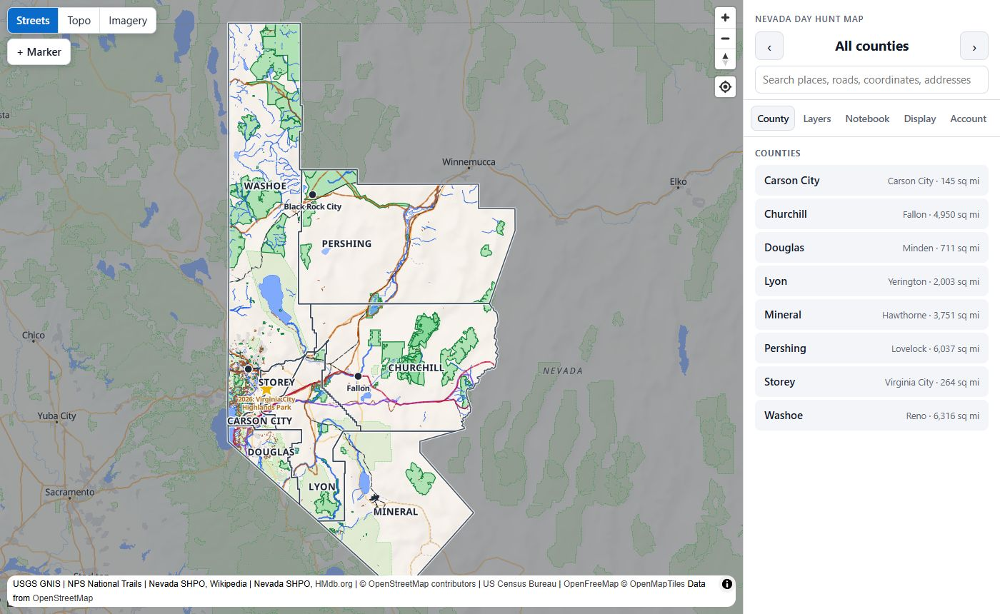
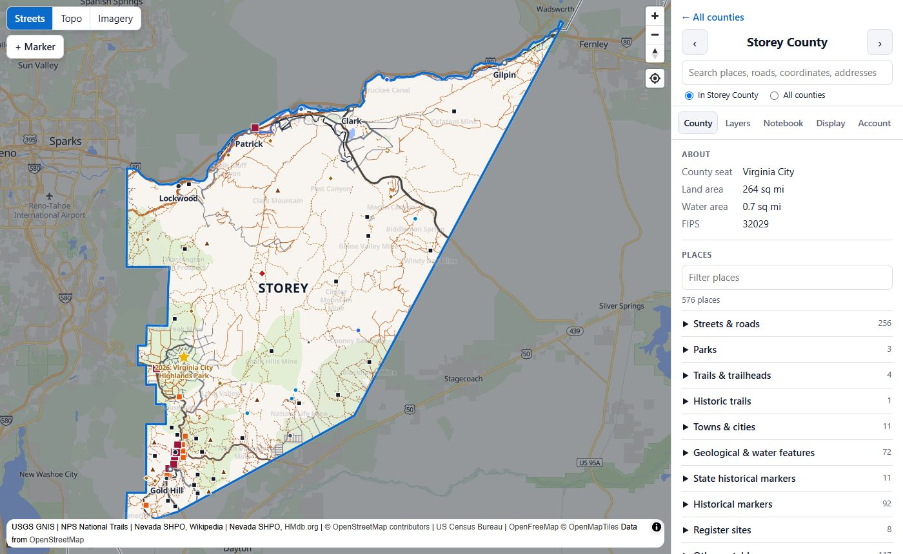
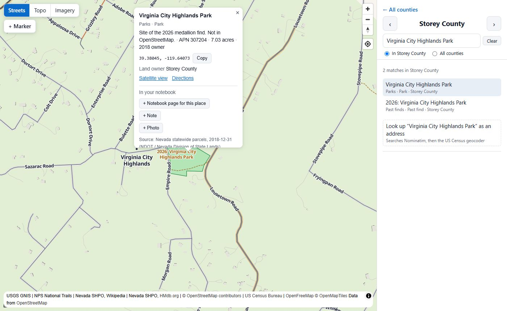
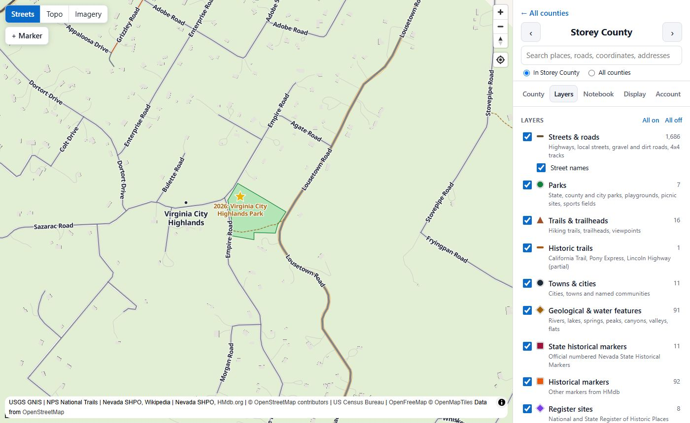
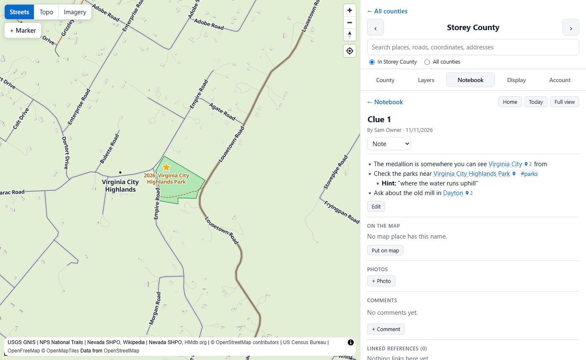
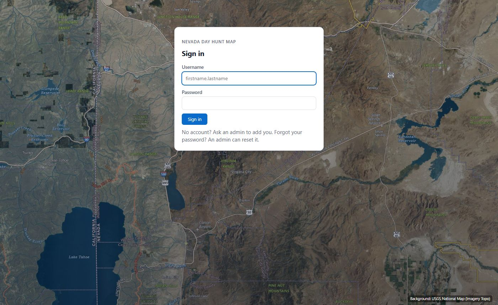
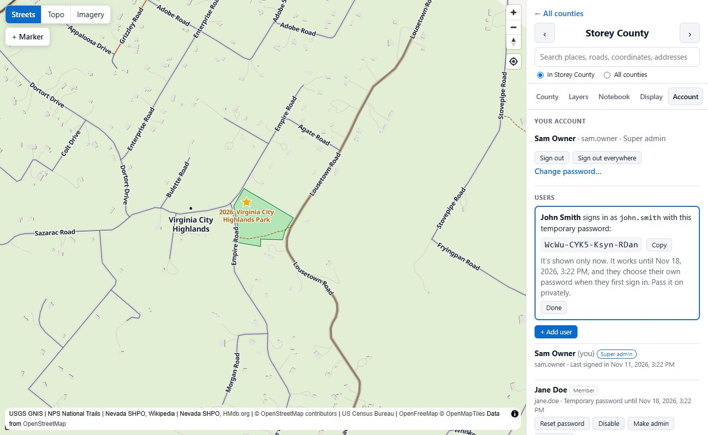
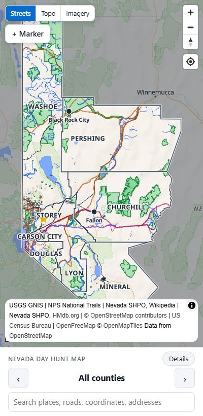

# Nevada Day Treasure Hunt Map

A scouting map and shared field notebook for the Nevada Day Treasure Hunt. It shows the eight hunt counties (Carson City,
Churchill, Douglas, Lyon, Mineral, Pershing, Storey and Washoe) with parks, trails, historical
markers, ghost towns, land ownership and more. A small team can then keep notes and clues
together.



## What it does

- **Map:** the eight counties on a street map, USGS topo or satellite imagery. Click a county to
  zoom in and list every named place in it.
- **Layers:** turn parks, trails, historic trails, towns, water and landforms, state historical
  markers, other markers, register sites, ghost towns, land ownership, mines and ruins, past finds
  and your own markers on or off.
- **Search:** place names, roads (`SR 341`, `I-80`), street addresses and coordinates in any
  common format (`39.38095, -119.64143` or degrees, minutes and seconds).
- **Notebook:** pages with `[[links]]` and `#tags`, backlinks, daily notes, photos and comments.
  Pages about map places are tied to the map.
- **Team accounts:** invitation only. Everyone shares one notebook, and everything shows who added
  it.
- **Works on a phone** as well as a desktop.

| Pick a county                                    | Click a place                                       |
| ------------------------------------------------ | --------------------------------------------------- |
|  |  |

| Layers                                        | Notebook                                           |
| --------------------------------------------- | -------------------------------------------------- |
|  |  |

## Getting started

You need [Node.js](https://nodejs.org/) 24 or newer and [Git](https://git-scm.com/).

1. **Download the project and install it:**

   ```
   git clone https://github.com/briansalazar-tech/ClaudeVibeCoding-NevadaDayTreasureHunt.git
   cd ClaudeVibeCoding-NevadaDayTreasureHunt
   npm install
   ```

2. **Create your settings file** by copying `.env.example` to `.env`:

   ```
   copy .env.example .env      (Windows)
   cp .env.example .env        (Mac or Linux)
   ```

   The defaults work as they are. In `GEOCODER_USER_AGENT`, replace the example email with your
   own: the address-search services ask for a contact.

3. **Start the app:**

   ```
   npm run dev
   ```

   Then open **http://localhost:5173** in your browser.

4. **Create the first account.** The first time, the app asks for a **setup code**. Look for it in
   the window where you ran `npm run dev`:

   ```
   No accounts yet. Open the app and create the super admin with this setup code:

       ABCD-EFGH-JKLM
   ```

   Enter it with your name and a password. This first account is the **super admin**, who owns the
   project.

5. **Invite your team.** Go to **Account → Users → + Add user**. The app makes a temporary password
   for each person. Pass it on yourself; no email is sent. They choose their own password the first
   time they sign in.

| Sign in                                        | Adding a user                                       | On a phone                                  |
| ---------------------------------------------- | --------------------------------------------------- | ------------------------------------------- |
|  |  |  |

## Who can do what

| Role            | Can do                                                                                                                         |
| --------------- | ------------------------------------------------------------------------------------------------------------------------------ |
| **Member**      | Add pages, notes, photos, markers and comments. Edit and delete their own.                                                     |
| **Admin**       | Everything a member can, plus edit anyone's content, add members, reset passwords, disable members, download backups.          |
| **Super admin** | Everything, plus make or remove admins, remove users, unlock locked-out accounts, restore backups and read the audit log.       |

## Everyday commands

| Command                                  | What it does                                                         |
| ---------------------------------------- | -------------------------------------------------------------------- |
| `npm run dev`                            | Start the app for use on your computer                               |
| `npm run build` then `npm run start`     | Build and run the faster production version                          |
| `npm run db:backup`                      | Save a copy of the database to `server/data/backups/`                |
| `npm run auth:reset -- --user first.last` | Print a new temporary password for someone (also works for yourself) |
| `npm run check`                          | Run the type checks, linting, tests and build                        |

Forgot your password? Run `npm run auth:reset -- --user your.name` on the computer running the app.

## Where things are kept

- **Your notes, pages, markers and accounts:** `server/data/hunt.db` (a SQLite file)
- **Photos:** `server/data/uploads/`
- **Map data:** `client/public/data/`, already included, so there's nothing to download

Both `server/data` folders stay on your computer and are never committed to Git. Back them up with
`npm run db:backup`. Admins can also download a backup from the Notebook's **Backup (.json)**
button.

## Updating the map data

The map data is already in the project. To rebuild it, for example for a new hunt year:

```
npm run data:fetch -- --all
npm run data:build -- --all
```

Most sources download on their own. The HMdb marker lists have to be downloaded by hand: `data:fetch`
prints the link for each county. See
[Reference-MD-Files/hunt-map-data-sources.MD](Reference-MD-Files/hunt-map-data-sources.MD) for
details on every source.

## Project layout

```
client/          The web app (React, MapLibre)
server/          The API and the SQLite database (Express)
shared/          Code used by both, such as the county list and permissions
data-pipeline/   Scripts that download and build the map data
docs/            Screenshots for this README
```

## Data sources and credits

- Map data © [OpenStreetMap](https://www.openstreetmap.org/copyright) contributors (ODbL)
- Basemaps: [OpenFreeMap](https://openfreemap.org/) and the
  [USGS National Map](https://www.usgs.gov/programs/national-geospatial-program/national-map)
- Historical markers: [HMdb.org](https://www.hmdb.org/) and the
  [Nevada State Historic Preservation Office](https://shpo.nv.gov/)
- Place names: USGS GNIS. Historic trails: National Park Service. Land ownership: Bureau of Land
  Management and county parcel records. County boundaries: US Census Bureau.
- Register sites and ghost towns: Nevada SHPO and Wikipedia
